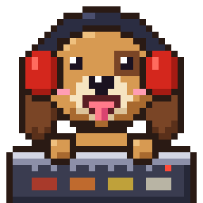

# odawg



Sound for Odin, in Tone.js's vocabulary: songs described as data (sections
with tempo, style, energy and chords; parts playing patterns in them),
composed into notes on a tempo map, streamed in realtime from anywhere (or
exported across every core), and asked questions a picture can follow (when
a section starts, where the kicks are). Deterministic: the same spec and
seed give the same samples, whatever the block size.

Styles: ambient, house, lofi, synthwave, chicago_house, booty_house,
acid_house. Instruments: Tone.js's synths, circuit models of the TR-808 and
TR-909 (`DrumMachine`) and a TB-303-style `AcidSynth` (accent, slide),
onimite's synth.lua voices, a `Sampler` over licence-checked sample sets
downloaded on first use, or your own (a set the song writes out, or an SFZ
file), a `Player` for clips. Styles can be your own files too. Effects: Tone.js's, causal and
streaming (reverb, delays, chorus, compressor, true-peak limiter, EQ, ...). A sibling
of ovg, o3d, oksl, odecs and ottis; onimite binds it for its videos. MIT
licensed. [API.md](API.md) is the design; [WORKFLOWS.md](WORKFLOWS.md) walks
through using it.

```sh
make build                                     # build/odawg
build/odawg timeline demo/explainer.json       # the form, the tracks, the findings
build/odawg render demo/explainer.json -o out/explainer.wav --master streaming --stems out/stems
build/odawg render demo/booty_house.json -o out/booty.wav --master streaming
build/odawg at demo/explainer.json drop@1m     # what plays there
build/odawg inspect demo/explainer.json        # render and check (peaks, clipping, silent parts, loudness)
build/odawg show demo/explainer.json style/house
make test
```

## Layout

Layers in directories, each importing only the ones above it in this list.
Every package is named `odawg_<directory>` (Odin wants package names unique
in a program, and a host links odawg with its own packages); code imports
them by their directory names (`import song "deps:odawg/song"`).

| package | what it holds |
| --- | --- |
| `base` | the rate, units, hashing and the seeded generator, `Span`, findings |
| `tempo` | Tone lengths (`"8n."`, `"2m"`, `"2:1:0"`), the tempo map (steps and ramps) |
| `theory` | notes, chords, keys, degrees, voice leading |
| `dsp` | signal primitives over slices: band-limited oscillators and unison, filters, envelopes, noise |
| `device` | `PARAM_TABLE` and `DEVICE_TABLE` (tables.odin): every option, and every instrument, preset and effect as a row with its defaults and its procs; the voices, synth.lua's presets, the drum machines and acid synth (machines.odin), the Player, the Sampler, the effects, the sample Bank (chunks that never move; lent and viewed, not copied) |
| `analyze` | loudness (EBU R128), true peak, loudness range (onimite's, ported) |
| `assets` | the sample register (every set's source, pinned SHA-256, licence, credit), a song's own sets and SFZ files (sets.odin, sfz.odin; read from its folder or through the host's `Bank_Host`), declaring sets and loading only the zones a song's notes reach (downloaded on first use into the user data folder), decoding (WAV; FLAC through odecs) |
| `spec` | the spec's flat tables and the one table-driven reader (JSON, or a host's tables as json.Value) |
| `song` | composing: the form, the arrangement (styles in `styles/*.json`), transitions; the note table and the questions; a mix of songs and clips on one timeline (a host's video); the sample keys a song needs |
| `render` | the engine (a stream: voice pools, effect states, dormant tracks, the master), an export (the stream cut into time segments on every core, handed to a sink in order: a WAV written as it comes, memory), mastering to a target, WAV |
| `check` | the checks, as rows |
| `tools/odawg` | the command line, its commands as rows |

The rules that keep it this way:

- **Kinds are rows, behaviour is a rule table.** An instrument, preset or
  effect is a `DEVICE_TABLE` row naming its procs; a value is its kind and a
  `Params` array. A play pattern, a field kind of the reader, a transition, a
  role's defaults, a check, a mastering target, a CLI command: each a row.
  Add a row, never a branch, and never a struct or parser per kind.
- **Flat tables, spans, indices.** The spec and the song are tables; records
  name their children by `Span` (first, count), never by pointer. Every note
  of a song is one `#soa` table sorted by track, with a time-order index.
- **`/` names**: `envelope/attack`, `drums/kick`, `sections/drop/bpm`.
- **Workers pool on data**: the owner sizes one slab, workers fill disjoint
  slots, the owner sums them in table order; each worker has its own scratch
  arena.
- **Realtime and exact**: voices and effects keep their state in tables and
  process any block causally, so a preview's 800-sample frames, a scrub and
  an export are the same samples; a seek chases sounding notes and (exact)
  pre-rolls the effects' tails, which is what lets an export split by time.
- **No caches, nothing held that isn't asked for.** Music is computed;
  only generated assets (a downloaded sample set) are stored, and never
  committed. An export holds one wave of segment buffers (a fixed budget),
  never the song; a song's bank holds the zones its notes play, in 16-bit
  at their own channel count; a track between its sounds is dormant (no
  work); a voice slot is its device's state size.

## Mascot

`tools/mascot` draws the dog (32×32 pixel art, an SVG with switchable
layers and PNGs): `odin run tools/mascot -- art`.
